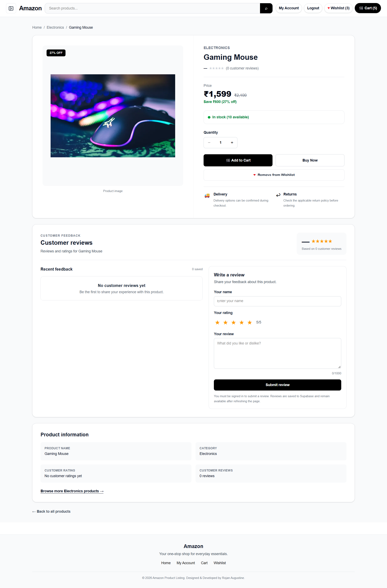
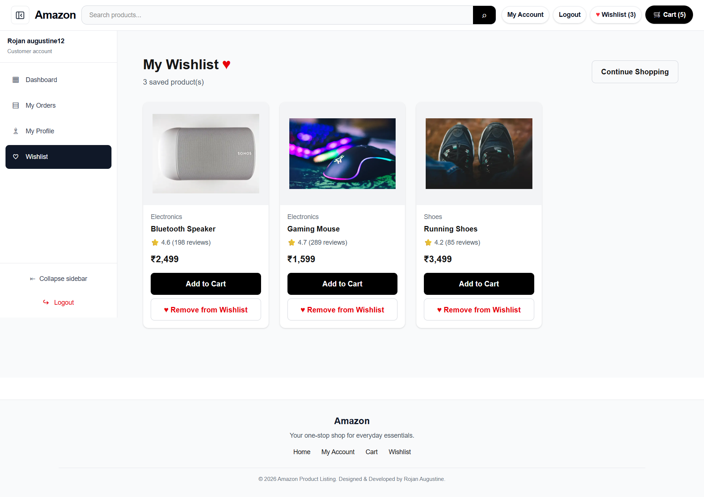
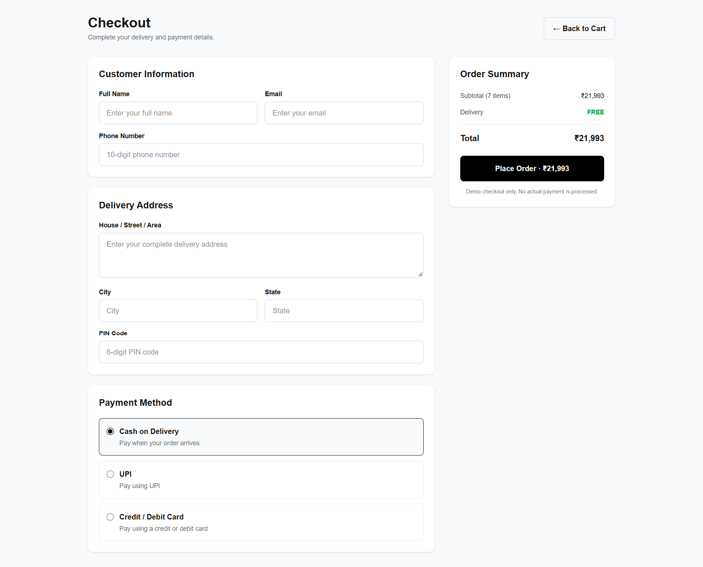
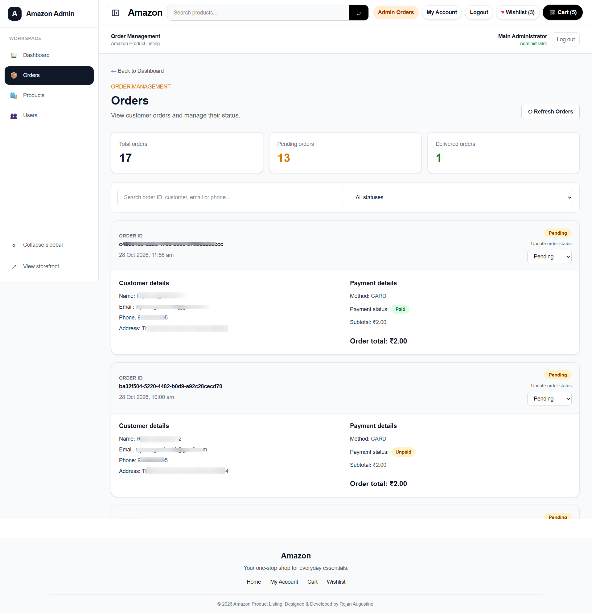
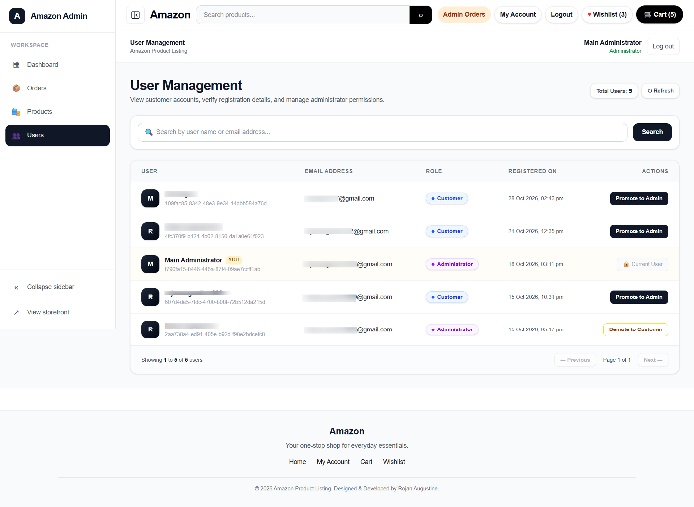
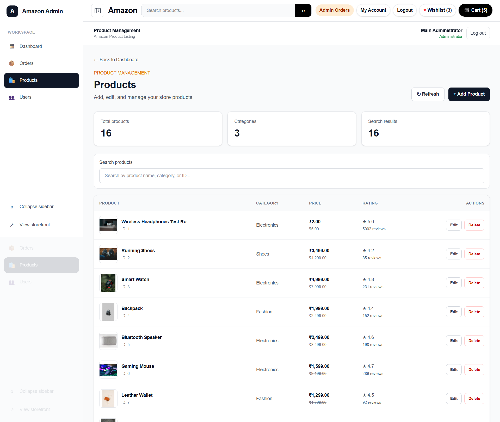

# Amazon Product Listing App

A responsive, full-stack e-commerce web application built with **Next.js, React, TypeScript, Tailwind CSS, and Supabase**. It demonstrates an end-to-end shopping experience, including product discovery, customer accounts, cart and wishlist management, checkout, payment integration, order history, reviews, and an admin dashboard.

## 🚀 Live Demo

- **Live Website:** [https://amazon-product-listing-roj.vercel.app/](https://amazon-product-listing-roj.vercel.app/)
- **GitHub Repository:** [https://github.com/rojanaugustine999/amazon-product-listing-roj](https://github.com/rojanaugustine999/amazon-product-listing-roj)

> **Note:** This is an independent portfolio project inspired by common e-commerce experiences. It is not affiliated with or endorsed by Amazon.

## 📸 Screenshots

The screenshots below are stored in the repository's `screenshots/` directory. Add or replace the image files using these names so the gallery renders correctly on GitHub.

### Storefront and Product Discovery


### Product Details



### Shopping Cart


### Wishlist



### Checkout and Payment



### Customer Account and Order History


### Admin Dashboard



### Admin User Management



### Product and Order Management



## ✨ Features

### Product Listing and Discovery

- Browse products and view individual product details.
- Search products by name.
- Filter products by category and price.
- Sort products using available sorting options.
- Navigate product listings with pagination.
- Display loading states and fallback product data.

### Shopping Cart

- Add products to the cart.
- Increase or decrease product quantities.
- Remove products from the cart.
- View cart item count, subtotal, and order summary.
- Validate available stock before adding products or changing quantities.
- Persist cart data using browser local storage.

### Wishlist

- Add products to and remove products from the wishlist.
- Keep wishlist items available between visits using local storage.

### Customer Authentication and Account

- Register, log in, and log out using Supabase Auth.
- Display customer account information.
- Associate customer orders with the authenticated account.
- Keep customer order history isolated between accounts.

### Checkout, Payments, and Orders

- Enter and validate shipping information.
- Complete the checkout flow.
- Integrate Razorpay for payment processing.
- Display an order confirmation after a successful order flow.
- Save orders and order items in Supabase.
- View previous orders in the customer account.
- Refresh order history and view order details/status where available.

### Product Reviews and Ratings

- Allow customers to submit product feedback and ratings.
- Display customer reviews and ratings on product pages.

### Admin Dashboard

- Provide a protected admin area for administrative tasks.
- Manage product and order information.
- View registered users through the user management page.
- Search users and refresh the user list.
- Promote eligible users to admin and demote admins to regular users.
- Prevent an administrator from demoting their own account.
- Prevent demotion of the last remaining administrator.
- Perform privileged user-management operations through server-side authorization.

### User Experience

- Responsive layouts for desktop, tablet, and mobile.
- Toast notifications for user actions.
- Loading, empty, and error states.
- Form validation and helpful error messages.
- Reusable components and shared React Context for application state.

## 🛠️ Technologies Used

| Technology | Purpose |
|---|---|
| Next.js | Application framework, routing, and server-side functionality |
| React | User interface and reusable components |
| TypeScript | Type safety and maintainable application code |
| Tailwind CSS | Responsive styling |
| Ant Design | UI components, where used |
| Supabase Auth | Customer authentication |
| Supabase Database | Store application data, including orders and related records |
| `@supabase/ssr` | Supabase client integration for server and browser environments |
| Razorpay | Payment gateway integration |
| React Context API | Shared cart, wishlist, and toast state |
| Local Storage | Persist cart and wishlist data in the browser |
| Vercel | Application deployment |
| Git and GitHub | Version control and source code hosting |

## 📂 Project Structure

The following is a high-level overview of the main project areas. Some files and folders may differ as the application evolves.

```text
amazon-product-listing-roj/
├── app/
│   ├── account/
│   ├── admin/
│   │   └── users/
│   ├── api/
│   │   └── admin/
│   │       └── users/
│   ├── cart/
│   ├── checkout/
│   ├── login/
│   ├── order-success/
│   ├── products/
│   ├── register/
│   ├── wishlist/
│   ├── layout.tsx
│   └── page.tsx
├── components/
├── context/
│   ├── CartContext.tsx
│   ├── ToastContext.tsx
│   └── WishlistContext.tsx
├── data/
│   └── products.ts
├── lib/
│   ├── supabase/
│   │   ├── admin.ts
│   │   ├── client.ts
│   │   └── server.ts
│   ├── api.ts
│   └── stock.ts
├── public/
├── screenshots/
│   ├── homepage.png
│   ├── product-details.png
│   ├── cart.png
│   ├── wishlist.png
│   ├── checkout.png
│   ├── account.png
│   ├── admin-dashboard.png
│   ├── admin-users.png
│   └── admin-management.png
├── package.json
└── README.md
```

## ⚙️ Run the Project Locally

### Prerequisites

- Node.js (LTS recommended) and npm.
- A Supabase project.
- Razorpay account and credentials if you want to test the payment integration.

### 1. Clone the repository

```bash
git clone https://github.com/rojanaugustine999/amazon-product-listing-roj.git
cd amazon-product-listing-roj
```

### 2. Install dependencies

```bash
npm install
```

### 3. Configure environment variables

Create a `.env.local` file in the project root and add the environment variables required by the application. At minimum, the Supabase browser configuration uses:

```env
NEXT_PUBLIC_SUPABASE_URL=your_supabase_project_url
NEXT_PUBLIC_SUPABASE_PUBLISHABLE_KEY=your_supabase_publishable_key
```

Add the server-only Supabase service-role key and the Razorpay credentials using the exact variable names expected by the application code. Keep all secret values on the server; never prefix secret keys with `NEXT_PUBLIC_`.

**Security:** Never commit `.env.local`, passwords, payment secrets, or the Supabase service-role key to GitHub. Configure production secrets in Vercel Project Settings. The service-role key bypasses normal Row Level Security protections, so it must only be used in trusted server-side code after authorization checks. Protect customer data with appropriate Supabase Row Level Security (RLS) policies.

### 4. Start the development server

```bash
npm run dev
```

Open [http://localhost:3000](http://localhost:3000) in your browser.

### 5. Build for production

```bash
npm run build
```

### 6. Start the production server locally

```bash
npm run start
```

## 🗄️ Database and Backend

The application uses Supabase for authentication and persistent application data.

### Authentication

Supabase Auth manages customer sign-up and login. Administrative routes should verify the signed-in user and their admin role on the server before performing privileged actions.

### Orders and Order Items

Order records include information such as:

- Customer ID and order status.
- Currency, subtotal, and total.
- Shipping details.
- Payment method and payment status.
- Order creation date.

Order item records include information such as:

- Associated order ID.
- Product ID and product name.
- Product image.
- Quantity.
- Unit price and line total.

### Admin User Management

The admin user-management functionality supports viewing and searching registered users and changing eligible user roles. Privileged operations are handled on the server and include safeguards against self-demotion and demoting the last administrator.

### Database Security

Configure suitable Supabase Row Level Security policies so customers can access only the records they are authorized to access. Never expose the Supabase service-role key in client-side code or public repository files.

> **Setup note:** Use the database tables, columns, and policies defined by the current project implementation. This README does not replace the SQL/schema configuration required by your Supabase project.

## 🧪 Testing Checklist

Use this checklist when testing the application. Mark an item complete only after verifying it in your current build and environment.

- [ ] Browse products and view product details.
- [ ] Search, filter, sort, and paginate products.
- [ ] Add, update, and remove cart items.
- [ ] Add and remove wishlist items; verify persistence after refresh.
- [ ] Register, log in, and log out.
- [ ] Complete checkout form validation.
- [ ] Test the Razorpay payment flow in the configured test environment.
- [ ] Verify successful payment/order confirmation and order persistence.
- [ ] View and refresh customer order history.
- [ ] Verify that customers cannot access another customer's orders.
- [ ] Submit and display product reviews and ratings.
- [ ] Verify that non-admin users cannot access admin pages or admin APIs.
- [ ] Search and refresh the admin user list.
- [ ] Test promoting a user and demoting an eligible admin.
- [ ] Verify self-demotion and last-admin protections.
- [ ] Check the application on desktop, tablet, and mobile layouts.
- [ ] Run `npm run build` successfully.

## 🚀 Deployment

The application is deployed using Vercel.

- **Production URL:** [https://amazon-product-listing-roj.vercel.app/](https://amazon-product-listing-roj.vercel.app/)
- Configure the required environment variables in the Vercel project settings.
- Redeploy after changing production environment variables.
- Keep server-only secrets, including service-role and payment credentials, out of client-side code and GitHub.

## 🔮 Future Improvements

- Expand automated tests for customer, payment, and admin workflows.
- Add order tracking and email notifications.
- Improve accessibility and performance.
- Improve monitoring and error reporting.

## 👨‍💻 Author

**Rojan Augustine**

- GitHub: [@rojanaugustine999](https://github.com/rojanaugustine999)
- Project repository: [Amazon Product Listing App](https://github.com/rojanaugustine999/amazon-product-listing-roj)
- Live project: [View Website](https://amazon-product-listing-roj.vercel.app/)

## 📄 License

This project is intended for learning and portfolio demonstration. Add a formal license if you plan to distribute or reuse the source code under specific terms.
