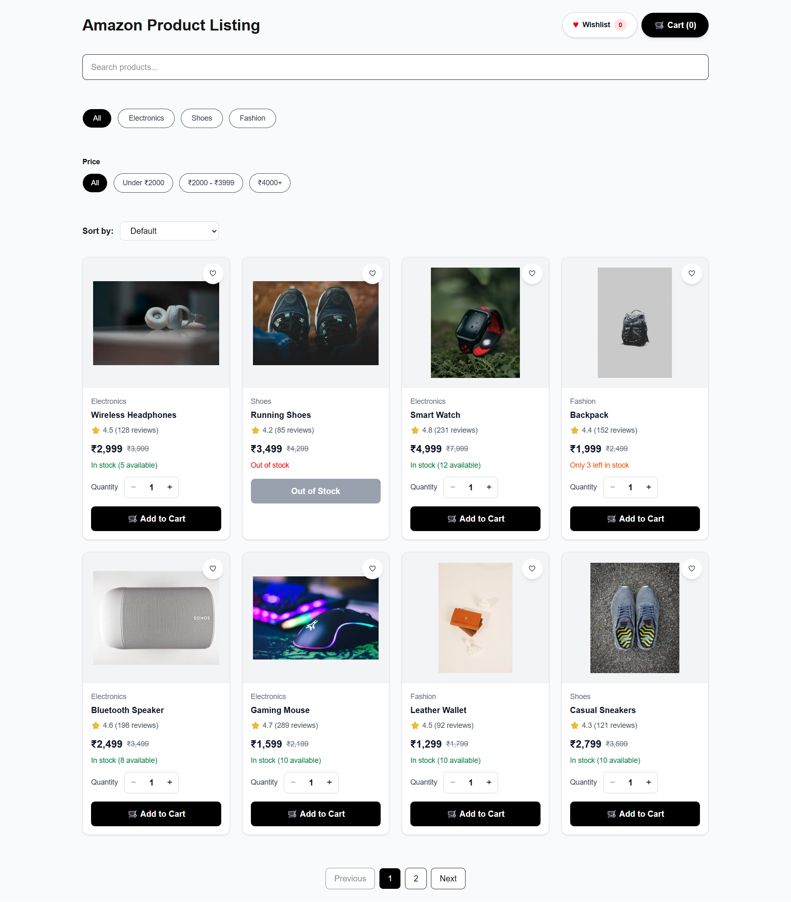
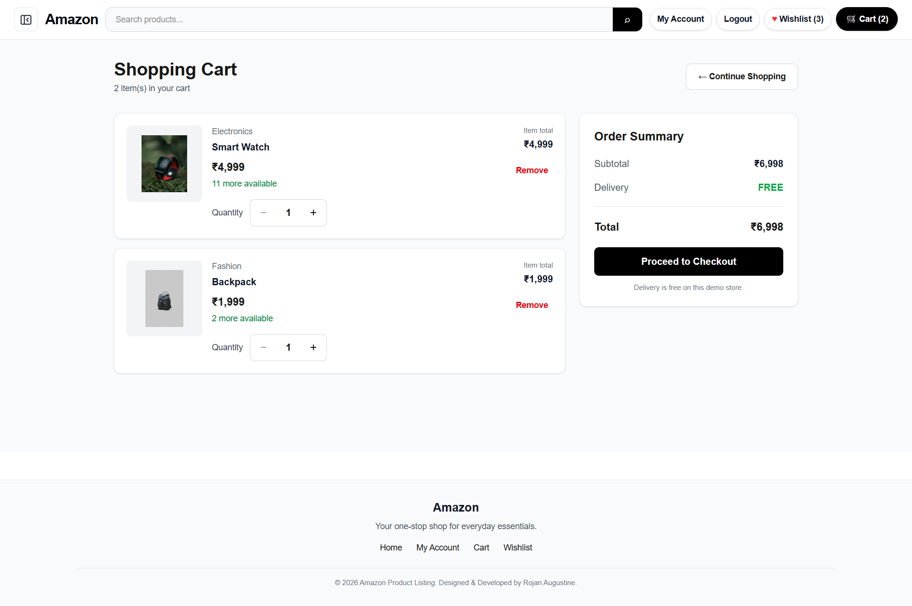
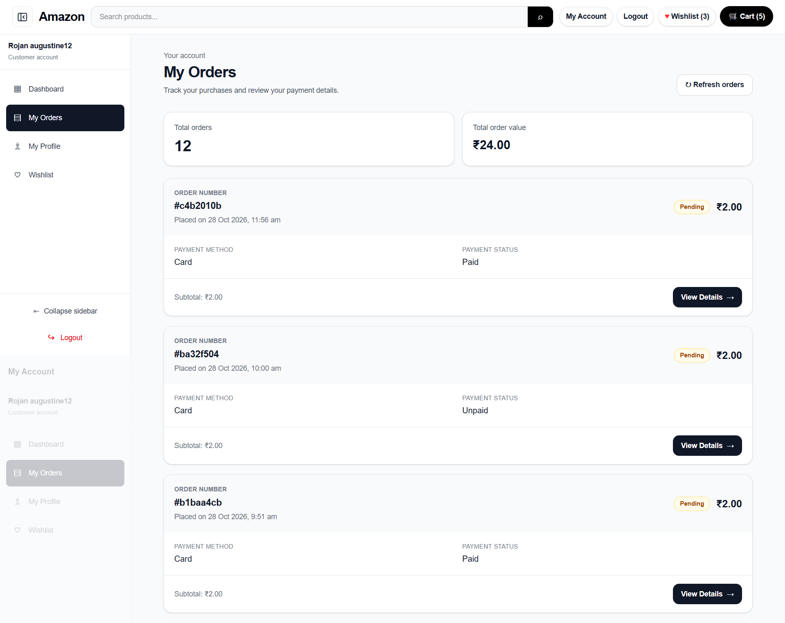

# Amazon Product Listing App

A responsive e-commerce demo built with Next.js, React, TypeScript, and Tailwind CSS. It includes product browsing, cart and wishlist functionality, checkout, user authentication, and customer order history.

## Live Demo

**Website:** https://amazon-product-listing-roj.vercel.app/

## Screenshots

<!-- Add screenshots to the repository and update these paths. -->
<!-- Example:  -->
<!--  -->

<!--  -->

<!--   -->

## Features

- Browse products and view product details
- Search, filter, sort, and paginate products
- Add products to the cart and wishlist
- Manage cart quantities and view totals
- Validate stock availability
- Complete a demo checkout flow
- Register and log in using Supabase Authentication
- View customer profile and order history
- Store orders and order items in Supabase
- Responsive layout for desktop and mobile
- Loading, error, and notification UI

## Technologies Used

- Next.js
- React
- TypeScript
- Tailwind CSS
- Supabase Authentication and Database
- Vercel
- Git and GitHub

## Getting Started

### 1. Clone the repository

```bash
git clone https://github.com/rojanaugustine999/amazon-product-listing-roj.git
cd amazon-product-listing-roj
```

### 2. Install dependencies

```bash
npm install
```

### 3. Configure environment variables

Create a `.env.local` file in the project root:

```env
NEXT_PUBLIC_SUPABASE_URL=your_supabase_project_url
NEXT_PUBLIC_SUPABASE_PUBLISHABLE_KEY=your_supabase_publishable_key
```

Replace the placeholders with your values from the Supabase dashboard. Do not commit `.env.local` or expose secret API keys.

### 4. Run the development server

```bash
npm run dev
```

Open http://localhost:3000 in your browser.

### 5. Create a production build

```bash
npm run build
```

## Database

Supabase is used for authentication and customer order storage. The application stores orders and their associated order items.

## Deployment

The application is deployed on Vercel:

https://amazon-product-listing-roj.vercel.app/

## Author

Rojan Augustine

GitHub: https://github.com/rojanaugustine999
